<div align="center">

<picture>
  <source media="(prefers-color-scheme: dark)" srcset="assets/dev-desk-dark.svg">
  <source media="(prefers-color-scheme: light)" srcset="assets/dev-desk-light.svg">
  
</picture>

# Hi, I'm Agung Nugroho 👋

<a href="https://github.com/ag-nugroho">
  
</a>

<p>
  
  <a href="https://github.com/ag-nugroho?tab=followers"></a>
  <a href="https://ag-nugroho.my.id"></a>
</p>

</div>

---

## 🎯 About Me

I'm a **Full-Stack Developer and Graphic Designer** from Indonesia 🇮🇩, with a D4 degree in Business Information Systems from Politeknik Negeri Malang. I like building the whole product: the interface people touch, the API behind it, and the data underneath. That is what the desk above shows: **UI → API → DB**.

```ts
const agung = {
  role: ["Full-Stack Developer", "Graphic Designer"],
  location: "Indonesia 🇮🇩",
  currentFocus: ["Laravel Development", "Next.js Apps", "Go Backend", "Big Data Analytics"],
  currentlyLearning: "Advanced Big Data Processing & Machine Learning",
  funFact: "I love building educational systems that gamify learning 🎮",
};
```

## 🧰 Tech Stack

<div align="center">

| Layer | Tools |
| :-- | :-- |
| **🎨 Frontend** |      |
| **⚙️ Backend** |       |
| **📱 Mobile** |    |
| **💬 Languages** |       |
| **🤖 AI** |   |
| **🛠️ Tools** |       |

</div>

## ⭐ Featured Work

| Project | What it is | Stack |
| :-- | :-- | :-- |
| **OOPedia** | My undergraduate thesis: a gamification-based platform for learning object-oriented programming. | Laravel · Next.js · MySQL |
| **iFarm Aqua** | Aquaculture business plan that placed in the Top 10 (8th of 640 teams) at the GenBINGO Bank Indonesia Business Plan Competition. | Business plan · Product concept |
| **Portfolio** | My personal site, rebuilt from scratch with a minimalist design. | Next.js · Tailwind CSS |

More at **[ag-nugroho.my.id](https://ag-nugroho.my.id)** 🚀

## 🏆 Hackathons & Competitions

| Event | Role | What I built |
| :-- | :-- | :-- |
| **Meta Global AI Developer Hackathon** (Oct 26 – Nov 4, 2026, Cerebral Valley × Meta) | AI Engineer | A tool that turns employment documents (work contracts, offering letters, NDAs, payslips, termination letters) into plain language anyone can understand. Flutter · Go · Muse Spark |
| **HackerRank Hackathon** (October 2026) | Participant | An AI-powered project built during the October edition |
| **GenBINGO – Bank Indonesia Business Plan Competition** | Team member | Top 10 (8th of 640 teams) with the iFarm Aqua business plan |

## 📊 GitHub Stats

<div align="center">


</div>

## 🤝 Let's Connect

<div align="center">

[](https://linkedin.com/in/ag-nugroho)
[](https://ag-nugroho.my.id)
[](mailto:your.email@gmail.com)

</div>

---

<div align="center">


*Great software is built not just with code, but with passion, creativity, and a sprinkle of coffee ☕*

**✨ Thanks for visiting! Let's build something amazing together. ✨**

</div>
